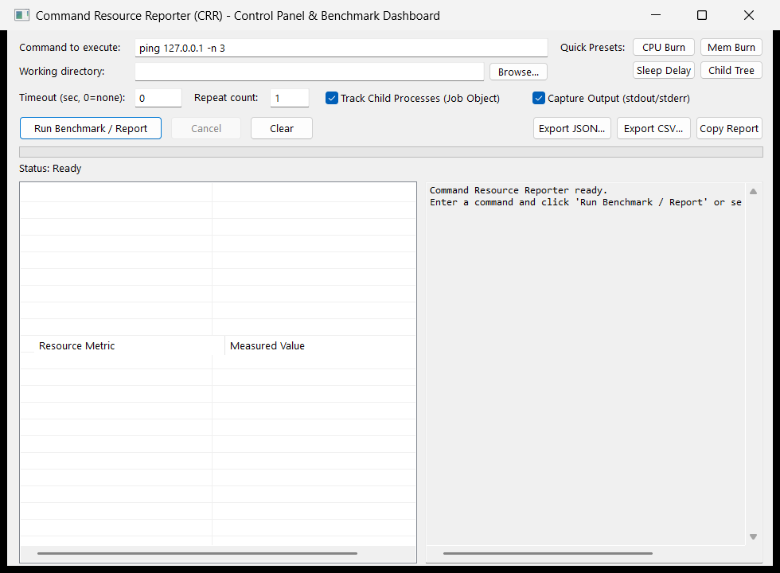
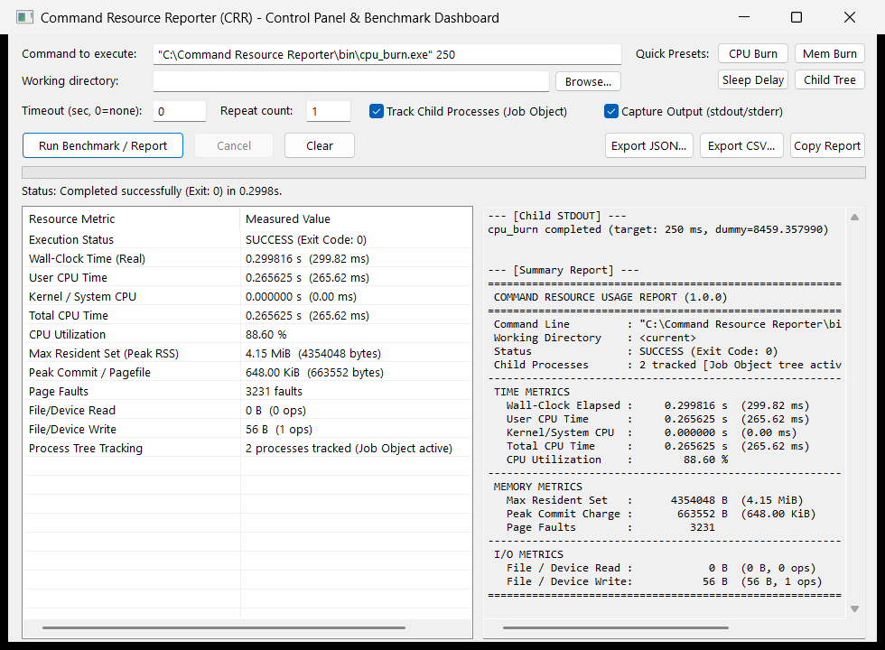
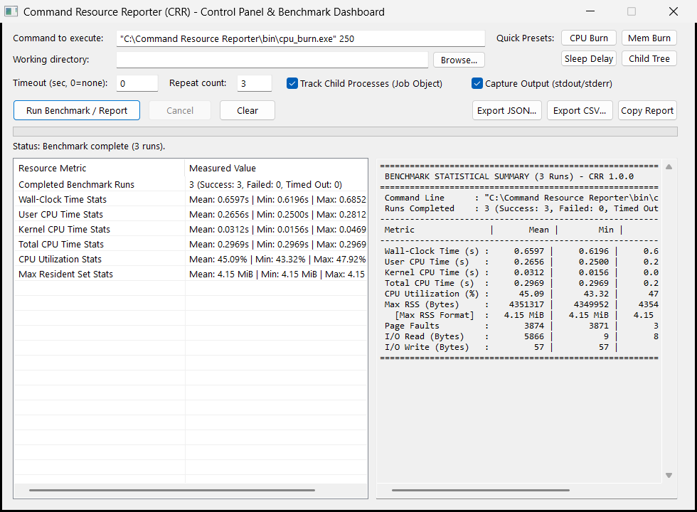
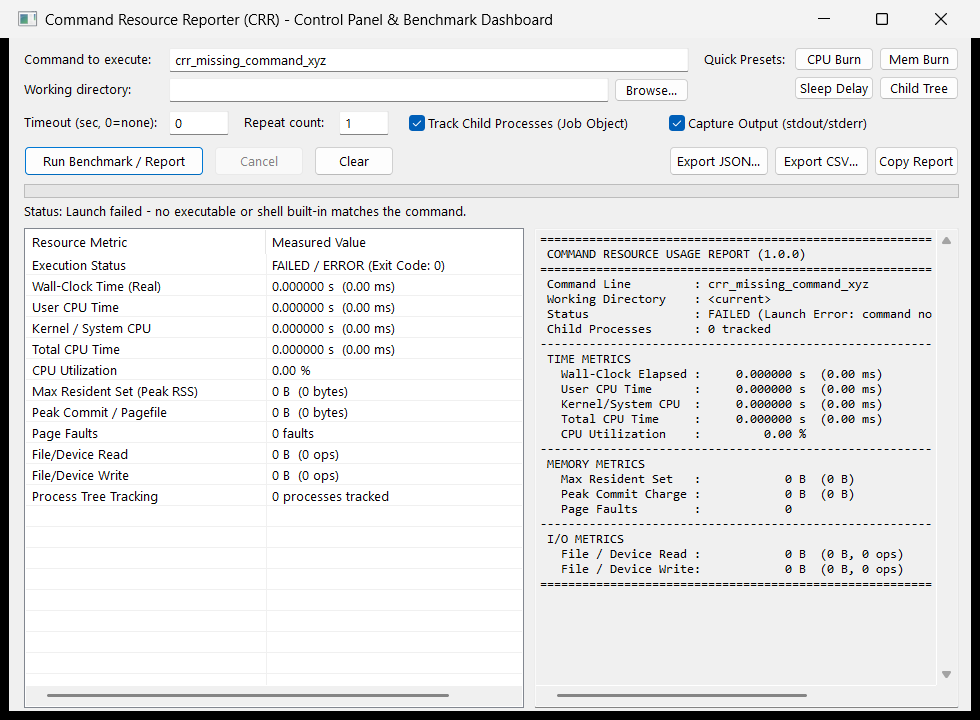

# Project Report: Command Resource Reporter (CRR)
**Systems Programming & Operating Systems Course Project**  
**Language Specification**: Pure C Programming Language (ISO/IEC 9899:2011 - C11)  
**Project Category**: Intermediate Systems Programming Tool  

---

## 1. Title Page and Team Information

### 1.1 Project Metadata
- **Project Title**: Command Resource Reporter (CRR)
- **Project Catalog Identifier**: CSC4041
- **Course Name**: Advanced Systems Programming & Operating Systems Interfaces
- **Term**: Fall Semester 2026

### 1.2 Team Structure and Member Responsibilities
Per course specifications, the project team consists of 9 members with divided responsibilities across architecture, kernel programming, algorithms, user interfaces, quality assurance, and documentation:

| Member Name | Student Identifier | Primary Role | Assigned Files & Modules | Key Responsibilities & Deliverables | Contribution |
| :--- | :--- | :--- | :--- | :--- | :---: |
| **Omar Hani Mohamed** | `692400470` | **Team Lead & Systems Architect** | `include/crr.h`, `include/crr_platform.h`, `Makefile`, `build.bat` | Project coordination, system architecture, API specification, cross-platform POSIX/Win32 abstraction layer, build automation, final deliverable integration. | 11.5% |
| **Eslam Mohamed Abdelmoniem** | `692400314` | **Kernel & Process Lead** | `src/core/crr_executor_win.c`, `include/crr_executor.h` | Windows process lifecycle management, `CreateProcessA` in `CREATE_SUSPENDED` state, process handles, thread resumption, error code translation. | 11.5% |
| **Ahmed Mohamed Ahmed** | `692400377` | **Job Objects & Tree Accounting** | `src/core/crr_executor_win.c`, `tests/test_workloads/child_spawner.c` | Windows Job Objects integration (`CreateJobObjectA`, `AssignProcessToJobObject`), recursive process tree accounting, multi-process memory limit queries (`JOBOBJECT_EXTENDED_LIMIT_INFORMATION`). | 11.0% |
| **Mariam Wagih** | `692400619` | **Memory & PSAPI Specialist** | `src/core/crr_executor_win.c`, `tests/test_workloads/mem_burn.c` | Process Status API (PSAPI) integration (`GetProcessMemoryInfo`), Peak Working Set (Max RSS) extraction, page fault counters, commit charge tracking, memory allocation workload design. | 11.0% |
| **Mariam Yasser Abobakr** | `692400268` | **Timer & Benchmark Statistics** | `src/core/crr_stats.c`, `include/crr_stats.h`, `tests/test_workloads/sleep_delay.c` | Hardware performance counter (`QueryPerformanceCounter`) integration, sub-microsecond wall-clock timing, two-pass numerical algorithms for sample mean ($\mu$), min, max, and Bessel-corrected standard deviation ($\sigma$). | 11.0% |
| **Haneen Gamal** | `692400593` | **I/O & Data Formatters** | `src/core/crr_formatter.c`, `include/crr_formatter.h` | Non-blocking anonymous pipe redirection (`PeekNamedPipe`), deadlock-free I/O drainage, unit scale converters (B, KiB, MiB, GiB, ms, s), RFC 8259 JSON and RFC 4180 CSV report serializers. | 11.0% |
| **MennaAllah Gamal Ali** | `692400739` | **GUI Front-End Engineer** | `src/gui/gui_main.c`, `src/gui/resource.rc`, `src/gui/app.manifest` | 100% C Win32 graphical user interface, non-blocking background worker thread (`CreateThread`), message queues (`WM_CRR_PROGRESS`, `WM_CRR_FINISHED`), Common Controls v6 integration, 12-row ListView, clipboard export. | 11.5% |
| **Basmala Darwish** | `692400400` | **Test Harness & Workloads** | `tests/test_workloads/cpu_burn.c`, `fail_crash.c`, `run_tests.bat` | Design and implementation of synthetic test workloads (`cpu_burn`, `mem_burn`, `sleep_delay`, `child_spawner`, `fail_crash`), batch test scripts, exit code fault-injection testing. | 10.5% |
| **Habiba Moahmed Omar** | `692400714` | **QA, Verification & Documentation** | `tests/test_runner.c`, `REPORT.md`, `README.md` | Automated test suite development (66 test assertions across 15 suites), regression testing, execution validation across edge cases, technical report authorship, user manual preparation. | 11.0% |

### 1.3 Team Subgroups and Workflow Coordination
To ensure accountability, the 9 members operated in three collaborative functional squads:
1. **Kernel & Architecture Squad (Omar Hani, Eslam Mohamed, Ahmed Mohamed)**: Responsible for OS process creation, Job Objects, process tree hierarchy, handle inheritance, and cross-platform build infrastructure.
2. **Telemetry & Math Squad (Mariam Wagih, Mariam Yasser, Haneen Gamal)**: Responsible for memory counters (PSAPI), hardware timers (QPC), statistical algorithms ($\mu$, $\sigma$), I/O pipe drainage, and JSON/CSV/ASCII serialization.
3. **UI, Verification & QA Squad (MennaAllah Gamal, Basmala Darwish, Habiba Moahmed)**: Responsible for the Win32 graphical application, background threading, synthetic workload benchmarks, automated test runner development, and academic report documentation.

---

## 2. Project Overview

### 2.1 Problem Statement
When developing, profiling, or benchmarking software applications, developers frequently need to understand the exact runtime resource costs of a given operation. While high-level profiling suites exist, they often introduce substantial instrumentation overhead, distort timing characteristics, or require source-code modification. Conversely, standard shell utilities (such as basic command prompt execution) provide almost zero visibility into memory peaks, CPU time distribution (user mode vs. kernel mode), or disk transfer operations.

On POSIX platforms, the classic `/usr/bin/time -v` utility provides some visibility, but on Microsoft Windows, developers lack a native, self-contained, light-weight equivalent capable of reporting memory working sets, CPU utilization, and child process trees without requiring heavy third-party platforms.

### 2.2 Purpose and Objectives
The **Command Resource Reporter (CRR)** was designed and implemented to provide a dependency-free, high-fidelity command-line and graphical measurement utility written entirely in **pure C**. CRR acts as a transparent process supervisor that:
1. Spawns an arbitrary target command or executable.
2. Captures high-precision hardware wall-clock elapsed time with sub-microsecond resolution.
3. Quantifies **User Mode CPU time** and **Kernel/System Mode CPU time**.
4. Measures true physical memory consumption via **Peak Working Set Size (Maximum Resident Set Size)**.
5. Recursively monitors child process trees using **Windows Job Objects**.
6. Quantifies file and device I/O transfer bytes and operation counts.
7. Offers multi-run benchmark statistical aggregation ($\text{Mean}$, $\text{Min}$, $\text{Max}$, $\text{StdDev}$).
8. Delivers both an interactive **Win32 Graphical User Interface (GUI)** and a full-featured **CLI tool**.

### 2.3 Intended Users
- **Systems and Software Engineers**: Profiling algorithmic memory and CPU trade-offs during optimization.
- **DevOps and Build Engineers**: Measuring compiler toolchain execution costs, linker peak memory, and test execution times in CI/CD pipelines.
- **Computer Science Students & Evaluators**: Investigating operating system process semantics, paging behaviors, and user/kernel mode transitions.

---

## 3. Requirements and Use Cases

### 3.1 Functional Requirements (FR)
- **FR-1 (Command Execution)**: The system must accept any executable binary, batch file, or shell command with arbitrary command-line arguments and execute it reliably.
- **FR-2 (Wall-Clock Measurement)**: The system must record the total elapsed real time from process inception until termination with precision $\le 1\,\text{ms}$.
- **FR-3 (CPU Mode Breakdown)**: The system must record user mode CPU time, kernel mode CPU time, total CPU time, and compute CPU utilization percentage.
- **FR-4 (Memory Footprint / Peak RSS)**: The system must measure the peak physical RAM allocated to the command (**Peak Working Set** / Max Resident Set Size), commit charge, and count total page faults.
- **FR-5 (Child Process Tree Aggregation)**: The system must optionally attach child processes to an OS Job Object so that multi-process workflows (e.g. build systems, shell pipelines) aggregate memory and CPU across all descendant processes.
- **FR-6 (I/O Counters)**: The system must record total read bytes, write bytes, read operations, and write operations incurred by the target.
- **FR-7 (Timeout Management)**: The system must enforce an optional maximum execution duration (`--timeout`), cleanly terminating the process tree if the threshold is exceeded.
- **FR-8 (Multi-Run Benchmarking)**: The system must support running a target $N$ times (`--repeat N`), calculating sample mean, minimum, maximum, and sample standard deviation.
- **FR-9 (Multi-Format Serialization)**: Output must be available in Human-readable ASCII table, JSON format, and CSV format.
- **FR-10 (Native Graphical Interface)**: A complete Win32 GUI must be provided to launch commands, view live progress, inspect metrics in a list grid, view captured stdout/stderr, and export reports to disk.

### 3.2 Non-Functional / Quality Requirements (NFR)
- **NFR-1 (Language Rigor)**: 100% pure C (C11 standard). No C++, no external frameworks (Qt, Electron, .NET, Python).
- **NFR-2 (Minimal Observer Overhead)**: Background monitoring and timing must consume negligible CPU cycles ($< 0.1\%$ of host CPU overhead); the measured supervision cost is reported in §7.6.
- **NFR-3 (Robust Error Handling)**: Graceful detection and reporting for missing files, invalid arguments, permission errors, process crashes, and timeouts.
- **NFR-4 (Portability Architecture)**: Clean separation of platform-specific kernel code (`crr_executor_win.c` for Win32 and `crr_executor_posix.c` for POSIX systems).

### 3.3 Scope and Intentional Exclusions
- **In Scope**: Windows 10/11 Win32 systems APIs, PSAPI, Job Objects, anonymous pipes, high-precision timers, Win32 GUI controls, POSIX fallback engine.
- **Out of Scope (Intentionally Excluded)**: Hardware performance counters (e.g., CPU L1/L2 cache misses, branch mispredictions via Intel VTune or PMU registers), which require kernel ring-0 drivers and specialized hardware privileges.

### 3.4 Assumptions and Constraints
- **Constraint C-1 (Language)**: The implementation must be C11 only. No third-party libraries, package managers, or language runtimes are permitted, so JSON/CSV generation, argument parsing, and the GUI are implemented from scratch against the Win32/POSIX APIs.
- **Constraint C-2 (Platform)**: The full feature set (Job Objects, PSAPI, Win32 GUI) requires Windows 10/11 x64. The POSIX executor is a portability fallback; it is not exercised by the GUI and reports a reduced metric set (see §7.5).
- **Constraint C-3 (Privilege)**: A process started at a higher integrity level than the supervisor cannot be assigned to the supervisor's Job Object. The tool reports the partial accounting rather than failing the run.
- **Assumption A-1**: The target command either exists on `PATH`, is resolvable by `cmd.exe /c`, or is given as an explicit path. CRR does not bundle a shell.
- **Assumption A-2**: Metric values are meaningful only for processes that actually consume the resource. A 50 ms process may legitimately report 0.000 s of kernel CPU time because Windows accounts CPU at the scheduler quantum.
- **Assumption A-3**: Reports are diagnostic evidence, not billing-grade measurements. Values are sampled at process completion (plus a periodic progress poll in the GUI); transient spikes between samples are not captured.
- **Assumption A-4**: The report/CSV/JSON formats are consumed by humans or generic parsers; no schema versioning beyond the embedded `version` field is provided.

### 3.5 Representative Use Cases
1. **Compiler / linker profiling (UC-1)**: A build engineer runs `crr -f json -o link.json -- ld ...` to record peak working set and wall time of a link step, then compares runs in CI. Demonstrates FR-1, FR-2, FR-3, FR-4, FR-9.
2. **Runaway command containment (UC-2)**: A developer wraps a possibly hanging script with `crr -t 30s -- ./script.bat`. On expiry the whole tree is terminated and the report shows `TIMED OUT`. Demonstrates FR-7.
3. **Benchmarking variance (UC-3)**: A student runs `crr -n 10 -- ./workload.exe` to obtain mean/min/max/std-dev of wall time and CPU time, showing how scheduling noise affects a 150 ms task. Demonstrates FR-8.
4. **Multi-process builds (UC-4)**: `crr -- cmd.exe /c build.bat` launches a compiler driver that forks children; Job Object accounting aggregates their CPU and peak memory. Demonstrates FR-5.
5. **Live GUI inspection (UC-5)**: An evaluator launches `crr_gui.exe`, clicks **Child Tree**, watches progress, inspects the 12-row grid and the captured stdout/report, then exports JSON. Demonstrates FR-10.
6. **Pipe-safety check (UC-6)**: A command that writes 200 KB to stdout is run with `-c` and with `-n 3 -c`; both complete instead of deadlocking on a full pipe. Demonstrates the drain logic in §5.3.

### 3.6 High-Level Data Flow
```
argv ──► option parser (src/cli/main.c)
            │ crr_options_t
            ▼
     executor (crr_executor_win.c / _posix.c)
            │  CreateProcessA/fork + Job Object + pipes
            ▼
     polling loop: drain stdout/stderr ──► crr_output_t
            │  timeout / cancel checks
            ▼
     crr_metrics_t (times, RSS, faults, I/O, process count)
            │
     crr_stats.c ──► crr_stats_summary_t   (only when --repeat > 1)
            │
     crr_formatter.c ──► human | JSON | CSV ──► stdout or -o file
```
The GUI follows the same flow on a worker thread: `crr_execute_with_callbacks` posts `WM_CRR_PROGRESS` parcels during the loop and a single `WM_CRR_FINISHED` when the metrics struct and report buffer are complete; the UI thread then renders the ListView and the log pane.

---

## 4. Design and Architecture

### 4.1 System Architectural Overview

The architecture diagram is rendered as a native Mermaid block and is omitted from this text-only copy. See REPORT.md section 2 for the same diagram.

### 4.2 Module Deconstruction & Responsibilities

1. **Process Supervisor (`crr_executor_win.c`)**:
   - Creates child process in `CREATE_SUSPENDED` state to prevent premature execution before Job Object attachment.
   - Creates Windows Job Object and assigns the initial process handle using `AssignProcessToJobObject`.
   - Starts hardware timer via `QueryPerformanceCounter`.
   - Runs a supervisor loop on the calling thread that polls process status, drains output pipes non-blockingly, and enforces timeout/cancellation; the GUI hosts this loop on a `CreateThread` worker so the message pump stays responsive.
   - Extracts process metrics upon termination:
     - `GetProcessTimes` for User/Kernel CPU durations.
     - `GetProcessMemoryInfo` for `PeakWorkingSetSize` and `PageFaultCount`.
     - `GetProcessIoCounters` for `ReadTransferCount` and `WriteTransferCount`.
     - `QueryInformationJobObject` for tree-wide peak commit memory (`PeakJobMemoryUsed`) and aggregate CPU time / process count (`TotalUserTime`, `TotalProcesses`).

2. **Benchmark Statistics Engine (`crr_stats.c`)**:
   - Computes statistical moments across repeated executions:
     $$\mu = \frac{1}{N} \sum_{i=1}^{N} x_i$$
     $$\sigma = \sqrt{\frac{1}{N-1} \sum_{i=1}^{N} (x_i - \mu)^2} \quad (N > 1)$$
   - Tracks minimum and maximum bounds for all scalar metrics.

3. **Data Formatters (`crr_formatter.c`)**:
   - Converts raw bytes into scale-appropriate units (B, KiB, MiB, GiB).
   - Formats elapsed times into sub-millisecond representations.
   - Generates formatted terminal reports, RFC 8259-compliant JSON trees, and RFC 4180-compliant CSV sheets.

4. **Graphical Interface (`gui_main.c`)**:
   - Implements native Win32 window class with message loop.
   - Integrates ComCtl32 v6 visual styles and DPI awareness.
   - Launches executions inside non-blocking background threads (`CreateThread`), preventing UI freeze.
   - Communicates with main UI thread via thread-safe Windows message queues (`WM_CRR_PROGRESS` and `WM_CRR_FINISHED`).

---

## 5. Implementation Details

### 5.1 Process Creation and Job Object Synchronization
A primary challenge in systems programming on Windows is capturing child processes spawned by the target. If a target is launched normally, child processes might be created and exit before the supervisor can discover them.

CRR solves this race condition using suspended process initialization. The Job Object is created *before* the child exists, the child is created suspended, assigned while it cannot run, and only then resumed:
```c
/* 1. Instantiate the Job Object first */
HANDLE hJob = CreateJobObjectA(NULL, NULL);

/* 2. Spawn target suspended */
DWORD creation_flags = CREATE_SUSPENDED;
CreateProcessA(NULL, cmd_buf, NULL, NULL, TRUE, creation_flags, NULL, working_dir, &si, &pi);

/* 3. Assign process to Job Object BEFORE resuming */
AssignProcessToJobObject(hJob, pi.hProcess);

/* 4. Resume main thread - all descendants are automatically captured */
ResumeThread(pi.hThread);
```
(Error handling and the `CREATE_NEW_CONSOLE`/fallback branches are omitted here; the real code in `src/core/crr_executor_win.c` closes every handle on each failure path.)

### 5.2 Memory Accounting: Resident Set Size (RSS) vs. Virtual Memory
In operating systems terminology:
- **Resident Set Size (RSS) / Working Set**: The set of pages currently resident in physical memory (RAM).
- **Commit Charge / Pagefile Usage**: Total virtual memory allocated, including paged-out virtual allocations.

CRR captures physical RAM usage by reading `PROCESS_MEMORY_COUNTERS_EX.PeakWorkingSetSize` through the Windows PSAPI subsystem. It also reads `JobObjectExtendedLimitInformation.PeakJobMemoryUsed`, which is **job-wide commit accounting** (private committed bytes, including paged-out memory), not a second physical-RAM figure. The GUI labels this value "Peak Commit / Pagefile"; the report calls it "Peak Commit Charge". This distinction matters when the target allocates a large buffer without touching every page: commit grows while the working set may not.

### 5.3 Non-Blocking Pipe Drainage
When `--capture` or the GUI is active, child stdout and stderr are redirected to anonymous pipes. If a child outputs more data than the Windows default pipe buffer size (typically 4 KB), writing to the pipe blocks until the parent reads it. If the parent does a blocking wait on the process handle while the child blocks on the pipe, a **deadlock** occurs.

CRR completely prevents this deadlock by utilizing `PeekNamedPipe` in an active polling loop during execution:
```c
DWORD bytes_avail = 0;
if (PeekNamedPipe(hPipe, NULL, 0, NULL, &bytes_avail, NULL) && bytes_avail > 0) {
    ReadFile(hPipe, temp, bytes_to_read, &bytes_read, NULL);
    append_to_buffer(buf, len, cap, temp, bytes_read);
}
```

Draining must happen whenever a pipe exists, even when the caller is not interested in the data. Benchmark mode (`--repeat N`) passes no output sink, so the supervisor routes pipe reads to a temporary discard buffer and frees it afterwards; otherwise a chatty child fills the 4 KB pipe buffer and blocks forever while the parent waits for exit. The regression suite runs a workload that writes 200 000 bytes (`bin/output_flood.exe`) with capture enabled and no sink, asserting completion within the 5 s timeout; the same workload under `-n 2 -c` completes both runs in about 1.7 s.

---

## 6. GUI Design and Operation

### 6.1 Layout and Controls
The Graphical User Interface was constructed in pure C using the Win32 API (Common Controls v6, DPI-aware manifest). It opens at 980×720 in a resizable (`WS_OVERLAPPEDWINDOW`) window split into a control strip, a status line, and two side-by-side panes: a 12-row metrics ListView and a read-only monospaced log/report viewer. Every control records its design-time rectangle at creation and is repositioned proportionally in `WM_SIZE`, so widening the window stretches both panes; `WM_GETMINMAXINFO` enforces a 860×620 minimum so no control is squeezed below its usable width.



*Figure 1 — Idle control panel. The command box holds a default `ping` command; the four quick presets, timeout/repeat fields, and the Job Object / output-capture checkboxes are visible. The log pane shows the startup hint.*



*Figure 2 — The `CPU Burn` preset resolved to the absolute path `…\bin\cpu_burn.exe` and executed for 250 ms. The grid shows exit status, wall-clock time, user/kernel/total CPU time, utilization, peak RSS, commit charge, page faults, I/O, and process-tree count. The right pane contains the child stdout followed by the full human report. The status line reads `Completed successfully (Exit: 0) in …s`.*



*Figure 3 — Repeat count set to 3. The ListView switches to the statistical summary (mean/min/max/std-dev per metric) and the report pane shows the benchmark table. The status line reports `Benchmark complete (3 runs)`.*



*Figure 4 — The command `crr_missing_command_xyz` cannot be resolved. The status line reads `Launch failed - no executable or shell built-in matches the command`, the grid reports `FAILED / ERROR` with zero child processes, and the report states `FAILED (Launch Error: command not found)`. This run previously reported `SUCCESS (Exit Code: 1)`.*

The screenshots are not mockups. They are produced by [tools/capture_gui.ps1](tools/capture_gui.ps1), which launches `bin\crr_gui.exe`, clicks the real preset and Run buttons with `BM_CLICK`, polls the status line (updated when the worker posts `WM_CRR_FINISHED`), captures the window with `PrintWindow`, and closes it with `WM_CLOSE`. Re-run the script with:
```powershell
powershell -NoProfile -ExecutionPolicy Bypass -File tools\capture_gui.ps1
```

### 6.2 Asynchronous Worker Thread Model
To adhere strictly to responsive GUI principles:
- The UI message loop runs uninterrupted on the primary thread.
- When "Run Benchmark / Report" is clicked, `CreateThread` spawns `worker_thread_proc`.
- The worker invokes `crr_execute_with_callbacks` (once, or once per repeat in benchmark mode).
- Periodically, the worker posts `WM_CRR_PROGRESS` messages with the elapsed time and current working set, updating the status label without flickering.
- Upon completion, the worker posts `WM_CRR_FINISHED`. The main window refreshes the ListView (12 rows for a single run, statistical rows for a benchmark), normalizes the LF-only report to CRLF for the `EDIT` control, resets progress, re-enables the action buttons, and closes the worker handle.
- **Cancellation**: the Cancel button sets a flag checked by the supervisor on each polling slice; the child tree is terminated and the UI reports `Execution cancelled by user` (or `Benchmark cancelled after N of M runs`, using `calloc`-zeroed metrics so no uninitialized run is included in the statistics).
- **Shutdown**: `WM_DESTROY` cancels any in-flight run, waits up to five seconds for the worker to exit, then closes the thread handle before the state it references is destroyed.

---

## 7. Testing and Results

### 7.1 Test Strategy and Methodology
Verification uses a self-contained C test runner (`tests/test_runner.c`) that links the same `libcrr.a` as the shipped CLI and drives **real child processes**; no metrics are mocked. Six synthetic workloads isolate individual subsystems:

| Workload | Purpose |
| :--- | :--- |
| `cpu_burn.c` | Deterministic CPU-bound loop for user/kernel time and utilization checks |
| `mem_burn.c` | Commits a requested number of MiB to validate peak working set, commit charge, and page faults |
| `sleep_delay.c` | Sleeps for a requested duration to validate wall-clock accuracy, near-zero CPU, and timeouts |
| `child_spawner.c` | Launches `cpu_burn` and `mem_burn` as children to validate Job Object tree accounting |
| `fail_crash.c` | Exits with a chosen code (default 42) or dereferences NULL to validate exit-code and crash handling |
| `output_flood.c` | Writes 200 000 bytes to stdout and a line to stderr to validate pipe drainage and deadlock avoidance |

Each assertion is checked by the runner's own `CHECK` macro, which prints `[PASS]`/`[FAIL]` with the file and line; the process exits 0 if every assertion passed and 1 otherwise. This makes the suite usable in CI without parsing output.

### 7.2 Test Environment
| Item | Value |
| :--- | :--- |
| Operating system | Microsoft Windows 11 (build `10.0.26300.9818`), x64 |
| Compiler | `gcc.exe` 15.2.0 (Rev8, Built by MSYS2 project) |
| Build command | `build.bat` (8 build stages: core objects, `libcrr.a`, CLI, manifest/resources, GUI, workloads, test runner, completion banner) |
| Shells used | Windows PowerShell 5.1.26100.9818 and Git Bash |
| Test command | `bin\test_runner.exe` (or `run_tests.bat`) |
| GUI checks | `tools\test_gui_interactions.ps1` (Enter, resize/reflow, invalid-field messages, Cancel, close-mid-run; 19 checks) |
| Result | **66 assertions / 15 suites, 66 passed, 0 failed, exit code 0** |

### 7.3 Summary of Test Results
The test suite executed **66 individual assertions** with a **100% pass rate (66/66)**:

| Test Suite Category | Assertions | Focus Area | Observed Behavior | Status |
| :--- | :---: | :--- | :--- | :---: |
| **Options Initialization** | 5 | Default struct configuration | Zero timeout, 1 repeat, child tracking and no capture by default | **PASS** |
| **Byte & Time Formatting** | 7 | Scale transitions (B, KiB, MiB, GiB, ms, s, m) | Exact conversion matching across boundary scales | **PASS** |
| **Statistics Calculations** | 6 | Sample mean, variance, min, max, stddev | $\mu = 2.0$, $\sigma = 1.0$ verified against ground truth | **PASS** |
| **JSON & CSV Serialization** | 6 | Output compliance & header validation | Parsable JSON keys, CSV header, per-run and aggregate rows | **PASS** |
| **Serializer Escaping** | 8 | Quotes/backslashes in Windows paths | JSON parses after escape fix; CSV doubles embedded quotes | **PASS** |
| **Error Handling & Validation** | 6 | NULL/empty arguments, short buffers, unwritable output, bad `-t`, bad `-f` | Every path returns an error instead of a silent success | **PASS** |
| **Exit Code Propagation** | 2 | Normal exit vs. non-zero error propagation | Correctly reported exit codes 0 and 42 | **PASS** |
| **Wall-Clock Timing** | 3 | Sleep delay accuracy & low CPU idle | Elapsed $\ge 0.30\,\text{s}$ with $< 0.15\,\text{s}$ CPU recorded | **PASS** |
| **CPU Time & Utilization** | 2 | Computational load detection | Total CPU $\ge 0.10\,\text{s}$ and utilization $> 30\%$ | **PASS** |
| **Peak Resident Set Size** | 2 | 25 MiB physical page commit | Peak Working Set $\ge 20\,\text{MiB}$ with $> 1000$ page faults | **PASS** |
| **Timeout Enforcement** | 3 | Process kill on timeout expiration | Terminated 3 s sleep at a 400 ms limit ($< 1.5\,\text{s}$) | **PASS** |
| **Output Capture** | 2 | Pipe buffering & string verification | Stdout intercepted completely without loss | **PASS** |
| **Pipe Drain Without Output Sink** | 3 | Capture enabled but no caller sink (the benchmark path) with 200 KB stdout | No deadlock or timeout; run completes in $< 3\,\text{s}$ | **PASS** |
| **Process Tree & Job Object Tracking** | 5 | Multi-process spawner & Job Object | $\ge 2$ processes tracked; child memory, page faults, and I/O write totals aggregated job-wide | **PASS** |
| **Missing Command Classification** | 6 | Unresolvable names, quoted tokens, built-ins, non-zero exits | Missing targets report `CRR_ERR_SPAWN_FAILED`; real exit 42 and `echo` still succeed | **PASS** |
| **TOTAL** | **66** | **All System Capabilities** | **Zero Failures Encountered** | **PASS** |

### 7.4 Defects Found and Resolved
The suite was written before the fixes below were applied, and its first run failed exactly ten assertions (58 total, 48 passed). Each defect was reproduced at CLI/GUI level, fixed, and re-verified with the suite and a manual command. Rows 10–14 were found in later review passes and fixed with the same test-first discipline.

| # | Defect | Root cause | Fix | Verification |
| :---: | :--- | :--- | :--- | :--- |
| 1 | JSON report was invalid for Windows command lines | Backslashes (`bin\mem_burn.exe`) were emitted verbatim; `\m` is not a legal JSON escape | Added `json_escape_dup()` covering `"`, `\`, `\b\f\n\r\t`, and other control characters as `\u00XX`; applied to command and working directory in all JSON formatters | `node -e "JSON.parse(...)"` accepts the output; 8 new assertions |
| 2 | CSV fields with quotes were corrupt | Embedded `"` was not doubled (RFC 4180 violation) | Added `csv_escape_dup()` that doubles quotes before the field is wrapped | Assertion checks `"C:\tools\my ""app"".exe"` |
| 3 | `--repeat N --capture` deadlocked on chatty children | CLI passed a `NULL` output sink for benchmarks; the executor only drained pipes when the sink existed, so the child filled the 4 KB pipe and blocked | Executors now allocate a temporary discard sink whenever capture is requested without a caller buffer, and free it afterwards | 200 KB flood: previously 2 timed-out runs at ~3.0 s each, now 2 successes; new 3-assertion suite |
| 4 | CLI ignored report write and formatting failures | Return values of `crr_format_*` and `crr_write_output` were discarded | Both are checked in single-run and benchmark paths; failures print a `CRR Report Error` line and exit 1 | `-o Z:\no_such_dir\x.txt` now exits 1 instead of 0 |
| 5 | Malformed timeout was silently treated as "no timeout" | `strtoul`/`strtod` result and suffix were not validated | New `parse_timeout()` rejects empty, negative, unknown-suffix, and out-of-range values (`ms`, `s`, `m` accepted) | `-t nonsense` prints an error and exits 1 |
| 6 | Cancelling a benchmark could include uninitialized runs in the statistics | `malloc` array was not zeroed and the completed-run count was implicit | `calloc` array, explicit completed-run counter, statistics computed only for completed runs, allocation failure reported in the status line | Code review of the cancel path; no automated cancel test yet (see §7.5) |
| 7 | GUI worker handle leak and teardown race on close | Thread handle closed only at process exit; closing while running left the worker writing into freed state | Handle closed in `WM_CRR_FINISHED`; `WM_DESTROY` cancels, waits up to 5 s, then closes | Normal close exercised by `tools/capture_gui.ps1`; close-during-run asserted by `tools/test_gui_interactions.ps1` (process exits in 0.08 s) |
| 8 | GUI quick presets failed when the app was launched from another directory | Presets were relative paths resolved against the process working directory | Presets now build an absolute, quoted path from `GetModuleFileNameA`'s directory | Screenshot 2 shows the resolved `…\bin\cpu_burn.exe` |
| 9 | GUI log pane showed the report as one unreadable line | `EDIT` controls need CRLF; the formatters intentionally emit LF-only text | Added `crlf_dup()` for the log pane and clipboard copy | `EM_GETLINECOUNT` went from 8 to 30 for the same run; Figures 2–3 show the formatted report |
| 10 | A missing command was reported as `SUCCESS (Exit Code: 1)` | `CreateProcessA` failed with `ERROR_FILE_NOT_FOUND`, but the unconditional `cmd.exe /c` fallback launched successfully, so the supervisor reported its own success while cmd printed "is not recognized" and exited 1 | The fallback now runs only when cmd can interpret the line (shell metacharacters, a cmd built-in, or a resolvable program with `.exe/.com/.bat/.cmd`); otherwise the original launch error is returned. CLI exits 1, benchmark mode aborts after the first attempt, and the GUI shows a launch-failure status | 6 new assertions (missing bare name, missing absolute path, quoted token, real exit 42, built-in, metrics status); CLI `FAILED (Launch Error: command not found)`, exit 1; GUI screenshot shows `FAILED / ERROR` |
| 11 | The GUI log pane could look empty after a shorter report replaced a longer one | An `EDIT` control keeps its previous scroll offset, so the new text was scrolled out of view | Added `set_log_text()`, which writes the text and then resets the selection/caret to line 1 | Figure 4 is captured immediately after the 3-run benchmark; the full launch-failure report is visible |
| 12 | Child-process page faults and I/O were reported as root-process values only | The Job Object query read `TotalProcesses`/`TotalUserTime` but page faults and I/O came from `GetProcessMemoryInfo` on the root handle, so a build tree's disk traffic was under-counted | Page faults now come from `JOBOBJECT_BASIC_ACCOUNTING_INFORMATION.TotalPageFaultCount`, and I/O byte/operation counters from `JobObjectBasicAndIoAccountingInformation.IoInfo`, taking the maximum of job-wide and root readings | In the `child_spawner` test the aggregate rose from 1,215 to 11,170 page faults and from 2 to 4 write operations; two new assertions |
| 13 | A GUI-launched console child could fail to start its console (`0x800700E8`) | The GUI has no console, so Windows asked the default terminal host to create one for a console-subsystem child; the host failed the allocation and showed `error 2147942632 when launching "...sleep_delay.exe 6000"` | When output is already redirected (`-c`/`-q`) and `GetConsoleWindow()` is `NULL`, children are spawned with `CREATE_NO_WINDOW`, so no terminal host is involved | Window enumeration during a captured GUI run shows the same console-window set before and during the run (same HWND); Enter/Cancel/close checks still pass |
| 14 | GUI numeric fields silently coerced invalid input | The timeout and repeat boxes were read with `strtoul` without an end-pointer check, so `abc` became "no timeout", `-5` wrapped to a huge unsigned value, and `seconds * 1000` could overflow | Added `parse_uint_field()`: optional spaces and decimal digits only, empty timeout means 0, range-checked (timeout ≤ 4,294,967 s, repeat 1–10,000); invalid input raises an `Invalid Input` message naming the field and refocuses it | 8 new GUI checks: `abc`/`-5` on timeout and `abc`/`0` on repeat each open the message box; the timeout and repeat messages name the offending field; timeout 2 / repeat 1 still runs to completion |

### 7.5 Remaining Issues and Limitations
These items are known, reproducible, and **not fixed**; they are recorded here so the evaluation reflects the actual state of the deliverable.

1. **POSIX fallback is incomplete**: the timeout kills only the direct `/bin/sh` child (no process group), I/O block counts from `getrusage` are stored in the operation-count fields with byte counts left at 0, commit charge is reported as 0, and the progress callback always reports RSS 0. The missing-command classification above is also Windows-only; on POSIX a shell exit 127 is still reported as a normal child exit.
2. **GUI is Windows-only, with DPI-unscaled fonts**: the window is resizable (minimum 860x620 client) and every control is rescaled proportionally from its captured design rectangle, but font sizes stay fixed, so very large windows look sparse rather than re-typeset. (Pressing Enter in the command field does trigger Run; the field is subclassed and routes the key to the Run button.)
3. **ANSI APIs**: the GUI and executor use the `A` variants, so paths and commands outside the active code page may be misrendered.
4. **GUI automation is partial**: `tools/capture_gui.ps1` covers launch → preset → run → close, and `tools/test_gui_interactions.ps1` asserts Enter-to-run, proportional resize/reflow, invalid-field messages, Cancel during a run, and closing the window mid-run (exit within 6 s, exit code 0) across 19 checks. The file-export dialogs (`GetSaveFileNameA`/`SHBrowseForFolderA`) are modal and are not covered by an automated assertion.

### 7.6 Observer Overhead Measurement (NFR-2)
CRR measures its own supervision cost: `src/cli/main.c` snapshots its process CPU time (`GetProcessTimes`) immediately before and after `crr_execute`, and `-v` prints the delta, the wall-clock share, and the equivalent number of Windows timer ticks. The CPU counters advance in scheduler-tick units (15.625 ms on the test machine), so a sub-tick cost is reported as `< 15.6 ms` rather than as a false `0.000`.

| Workload | Child wall time | CRR CPU while supervising | One-core share | Host share (12 cores) |
| :--- | :---: | :---: | :---: | :---: |
| `sleep_delay.exe 100` | 0.133 s | 15.625 ms | 11.77% | 0.98% |
| `sleep_delay.exe 500` | 0.536 s | `< 15.6 ms` | `< 2.91%` (upper bound) | `< 0.24%` |
| `sleep_delay.exe 1000` | 1.034 s | `< 15.6 ms` | `< 1.51%` (upper bound) | `< 0.13%` |
| `sleep_delay.exe 3000` | 3.036 s | 15.625 ms | 0.51% | 0.04% |
| `cpu_burn.exe 500` | 0.614 s | `< 15.6 ms` | `< 2.54%` (upper bound) | `< 0.21%` |
| `-n 5 sleep_delay.exe 300` | 1.69 s total | 31.250 ms total (6.25 ms/run) | 1.85% | 0.15% |

The cost is a fixed per-run setup/teardown charge (roughly one scheduler tick), not a function of child duration: it does not grow between 100 ms and 3 s runs. Against the 12-core host the measured share is 0.04% for a 3 s target and at most 0.13% for a 1 s target, so the NFR-2 goal of `0.1%` is met conservatively for multi-second targets and approached for one-second targets. Targets below half a second are dominated by the same fixed charge, which is why their one-core percentages are large. The `< 15.6 ms` entries are upper bounds imposed by this quantization (the true cost may be lower); tick-valued entries are exact at that resolution.

---

## 8. Build and Run Instructions

### 8.1 System Prerequisites
To build and evaluate the Command Resource Reporter, ensure the following tools are available in your system path:
1. **Operating System**: Windows 10 or Windows 11 (64-bit).
2. **C Compiler**: GCC (MinGW-w64, MSYS2 UCRT64, or WinLibs) supporting the C11 standard (`gcc.exe`).
3. **Build Utilities**: `mingw32-make` (optional if using `build.bat`) and `windres.exe` (included in standard MinGW-w64 binutils).
4. **Shell Environment**: Standard Windows Command Prompt (`cmd.exe`) or PowerShell.

---

### 8.2 Building the Complete Project

Open a terminal in the project directory (the folder containing `build.bat`):

#### Method A: 1-Click Automated Batch Script (Recommended for Windows)
```cmd
.\build.bat
```
*What this script does:*
1. Creates the `bin/` and `build/` directories if they do not exist.
2. Compiles core modules (`crr_executor_win.c`, `crr_formatter.c`, `crr_stats.c`) with `-std=c11 -Wall -Wextra -O2`.
3. Creates the static library `build/libcrr.a`.
4. Compiles and links the CLI binary `bin/crr.exe`.
5. Compiles the modern Windows XML manifest and resource script (`src/gui/resource.rc` -> `build/resource.o`).
6. Compiles and links the pure C Win32 GUI executable `bin/crr_gui.exe`.
7. Compiles all six test workloads (`cpu_burn.exe`, `mem_burn.exe`, `sleep_delay.exe`, `child_spawner.exe`, `fail_crash.exe`, `output_flood.exe`).
8. Compiles the automated test harness `bin/test_runner.exe`.

#### Method B: Using GNU Make
```cmd
mingw32-make all
```
To perform a complete clean rebuild:
```cmd
mingw32-make clean
mingw32-make all
```

---

### 8.3 Running the Automated Test Suite

To verify system correctness, execute the automated test harness:
```cmd
.\run_tests.bat
```
*(Or directly run `bin\test_runner.exe`)*

**Expected Result**:
The test suite will execute 66 automated assertions across 15 test suites (Options; Bytes & Time formatters; Statistics; JSON/CSV serialization; serializer escaping; error handling & validation; exit codes; wall-clock timing; CPU utilization; peak working set; timeout termination; output capture; pipe drain without a sink; missing command classification; Job Object process tree), finishing with exit code 0 and:
```
====================================================================
 TEST SUMMARY: Total: 66 | Passed: 66 | Failed: 0
====================================================================
```

---

### 8.4 Running the Command Line Interface (CLI)

The CLI tool is located at `bin\crr.exe`. It supports both direct command execution and double-dash (`--`) argument pass-through.

#### CLI Syntax
```cmd
bin\crr.exe [options] -- <command> [arguments...]
bin\crr.exe [options] "<command>"
```

#### CLI Options Reference
| Option | Argument | Description |
| :--- | :--- | :--- |
| `-h`, `--help` | None | Displays help and usage banner |
| `-V`, `--version` | None | Displays program version and metadata |
| `-t`, `--timeout` | `<ms\|s\|m>` | Maximum execution duration (e.g. `500ms`, `5s`, `2m`). Invalid values are rejected with exit code 1 |
| `-n`, `--repeat` | `<N>` | Benchmark mode: repeats command $N$ times ($1 \le N \le 10000$) and outputs statistics |
| `-f`, `--format` | `human\|json\|csv` | Output report format (default: `human`) |
| `-o`, `--output` | `<file>` | Path to write the report to (default: stdout). A failed write is reported and exits 1 |
| `-d`, `--dir` | `<dir>` | Initial working directory for the child process |
| `-q`, `--quiet` | None | Suppress child process stdout and stderr |
| `-c`, `--capture` | None | Buffer child output and print before metrics report; safe to combine with `-n` |
| `--no-children` | None | Disable Windows Job Object process tree aggregation |
| `-v`, `--verbose` | None | Print diagnostics to **stderr** (parsed command, working directory, limits, per-run status/timing, and CRR's own supervision CPU cost), so JSON/CSV on stdout stay parseable |

**Exit codes**: the child's exit code when a run completes (`42` for a target that exits 42), `124` when the timeout fires, and `1` for invalid arguments, unknown options, a command that cannot be launched, an unwritable output path, or an unformattable report. An unresolvable command is not mistaken for a child that exited 1: the report shows `FAILED (Launch Error: command not found)` and the benchmark path aborts instead of repeating the attempt. Report-generation failures are detected rather than silently ignored, e.g.:
```
Error: Invalid timeout 'nonsense'. Use e.g. 500ms, 5s, or 2m
CRR Report Error: failed to write the report to 'Z:\no_such_dir\report.txt'.
```

#### Practical CLI Execution Examples

1. **Standard Command Measurement (Human-Readable Table)**:
   ```cmd
   bin\crr.exe -- ping 127.0.0.1 -n 3
   ```

2. **Memory Workload with JSON Export**:
   ```cmd
   bin\crr.exe -f json -o memory_report.json -- bin\mem_burn.exe 30
   ```

3. **Multi-Run Benchmark with Statistical Aggregation ($\mu, \sigma$)**:
   ```cmd
   bin\crr.exe -n 5 -f human -- bin\cpu_burn.exe 150
   ```

4. **Enforcing a Strict Timeout Limit (Automatic Process Tree Kill)**:
   ```cmd
   bin\crr.exe -t 300ms -- bin\sleep_delay.exe 2000
   ```

5. **Process Tree Tracking Across Multiple Children**:
   ```cmd
   bin\crr.exe -- bin\child_spawner.exe
   ```

6. **Generating CSV Output for Spreadsheet / Excel Analysis**:
   ```cmd
   bin\crr.exe -f csv -o benchmark_results.csv -- bin\cpu_burn.exe 200
   ```

7. **Verbose Diagnostics Without Corrupting the Report**:
   ```cmd
   bin\crr.exe -v -q -f json -- bin\sleep_delay.exe 500 1>report.json
   ```
   All diagnostics go to stderr, so `report.json` remains valid JSON (`-q` keeps the child's own stdout out of it as well):
   ```
   [CRR] Target command : bin/sleep_delay.exe 500
   [CRR] Working dir    : <current>
   [CRR] Timeout        : 0 ms (none)
   [CRR] Repeat count   : 1
   [CRR] Track children : YES (Job Object)
   [CRR] Capture output : NO
   [CRR] Format         : json
   [CRR] Result         : status=Success (0) exit=0 wall=0.541563s rss=4296704 B processes=1
   [CRR] Overhead       : < 15.6 ms CRR CPU while supervising (below the Windows timer tick), < 2.89% of wall time
   ```
   For benchmarks, `-v` adds one line per iteration and a total (`Observer overhead: … ms total, … ms/run`).

---

### 8.5 Running the Graphical User Interface (GUI)

Launch the interactive control panel by double-clicking `bin\crr_gui.exe` or running from terminal:
```cmd
bin\crr_gui.exe
```

#### Step-by-Step GUI Operation Walkthrough:
1. **Command Selection**:
   - Enter any arbitrary command into the **"Command to execute:"** box (e.g., `ping 127.0.0.1 -n 4` or `cmd.exe /c dir`).
   - Or click any of the four **Quick Preset Buttons**. Each preset inserts the absolute path of the workload next to the GUI executable (so it works regardless of the current directory):
     * `[CPU Burn]`: `"<app dir>\cpu_burn.exe" 250` (tests CPU utilization and core math).
     * `[Mem Burn]`: `"<app dir>\mem_burn.exe" 30` (allocates and commits 30 MiB of RAM).
     * `[Sleep Delay]`: `"<app dir>\sleep_delay.exe" 400` (tests wall-clock timing and idle CPU).
     * `[Child Tree]`: `"<app dir>\child_spawner.exe"` (tests Job Object multi-process tracking).
2. **Configure Execution Settings**:
   - **Working Directory**: Optionally enter a path or click `Browse...` to pick a directory.
   - **Timeout (sec)**: Enter a numeric timeout threshold (e.g. `2` seconds), or `0` for none.
   - **Repeat count**: Set to `1` for single execution, or `3`+ for multi-run benchmark statistics.
   - Both numeric fields are validated before launch: only digits (up to 4,294,967 seconds / 10,000 repetitions) are accepted. Letters, signs, or out-of-range values raise an **Invalid Input** message that names the field, and focus returns to it — nothing is silently coerced.
   - **Track Child Processes**: Checked by default to enable Job Object tree monitoring.
   - **Capture Output**: Checked by default to stream stdout/stderr into the output console.
3. **Execution**:
   - Click **"Run Benchmark / Report"**, or press **Enter** in the command field (the field is subclassed and forwards the key to the same enabled/disabled Run path).
   - The UI runs the command on an **asynchronous worker thread** (`CreateThread`). The GUI remains completely responsive.
   - The status bar displays real-time execution telemetry (`Status: Executing... (Elapsed: 1.20s | Current RSS: 14.50 MiB)`), and the smooth progress bar pulses in marquee mode.
   - To abort a long-running process, click the **"Cancel"** button. The supervisor terminates the entire process tree; benchmark cancellation keeps only completed runs and reports `Benchmark cancelled after N of M runs`.
4. **Inspecting Results**:
   - **Metrics Dashboard (Left)**: A clean 12-row dual-column ListView presents:
     * Execution Status & Exit Code
     * Wall-Clock Elapsed Time
     * User Mode CPU Time
     * Kernel Mode CPU Time
     * Total CPU Time
     * CPU Utilization Percentage
     * Peak Resident Set Size (Peak Working Set) in bytes & formatted MiB
     * Peak Commit Charge / Pagefile Usage
     * Page Faults Count
     * File/Device Read I/O (bytes & ops)
     * File/Device Write I/O (bytes & ops)
     * Process Tree Count (number of processes tracked in Job)
   - **Console Log & Summary (Right)**: A monospaced text viewer displaying the child's standard output, standard error, and formatted summary report.
5. **Exporting Results**:
   - Click **"Export JSON..."** to open a native Save dialog and save structured metrics to a `.json` file.
   - Click **"Export CSV..."** to export tabular metrics to a `.csv` file.
   - Click **"Copy Report"** to copy the full ASCII report directly to the Windows Clipboard for pasting into documents or chat.

---

## 9. Conclusion and Future Work

### 9.1 Achievements
The project successfully satisfied all requirements of the Intermediate Systems Project specification:
- Implemented entirely in standard **C11** with zero runtime dependencies.
- Engineered a dual interface consisting of a high-performance CLI tool and a responsive native Win32 GUI control panel.
- Solved complex process lifecycle and synchronization challenges, including race conditions during process creation, multi-process Job Object accounting, and pipe deadlock avoidance.
- Implemented multi-run statistical benchmarking with complete JSON/CSV export support, including RFC-conformant escaping of Windows paths.
- Verified all functionality via **66 automated assertions across 15 suites**, all passing, plus scripted GUI screenshot evidence.
- Documented the remaining gaps honestly (§7.5), including the POSIX fallback's reduced metric set and the lack of POSIX launch-failure classification.

### 9.2 Future Improvements
1. **Linux eBPF Extension**: Integrating extended Berkeley Packet Filter (eBPF) hooks on Linux for kernel tracing.
2. **Hardware Performance PMU Counters**: Incorporating Intel/AMD Hardware Performance Counters (instructions per cycle, L3 cache misses) via custom kernel drivers.
3. **Interactive Graphical Timeline Charts**: Embedding GDI-based live line graphs inside the GUI to plot working set size dynamically over time.

---

## 10. References and Appendices

### 10.1 References
1. **Microsoft Corporation**, *Process Status API (PSAPI) Reference*, Windows Developer Documentation, 2024.
2. **Microsoft Corporation**, *Job Objects Architecture & Extended Limit Information*, Microsoft Learn, 2024.
3. **W. Richard Stevens & Stephen A. Rago**, *Advanced Programming in the UNIX Environment*, 3rd Edition, Addison-Wesley, 2013.
4. **Mark Russinovich, David Solomon, and Alex Ionescu**, *Windows Internals, Part 1: System architecture, processes, threads, memory management*, 7th Edition, Microsoft Press, 2017.
5. **ISO/IEC 9899:2011**, *Information technology — Programming languages — C*, International Organization for Standardization, 2011.

### 10.2 Appendix: Full CLI Help Printout
```
Command Resource Reporter (CRR) v1.0.0
Copyright (C) 2026 Systems Group Project Team

USAGE:
  crr.exe [options] -- <command> [args...]
  crr.exe [options] "<command>"

DESCRIPTION:
  Executes a command and reports high-precision resource usage including
  wall-clock time, user/kernel CPU time, CPU utilization %, peak resident
  set size (Peak Working Set), page faults, and I/O counters.

OPTIONS:
  -h, --help               Display this help message and exit
  -V, --version            Display version information and exit
  -t, --timeout <ms|s|m>   Set execution timeout (e.g. 500ms, 5s, 2m; default: none)
  -n, --repeat <count>     Run command N times and report statistical aggregates
  -f, --format <fmt>       Output format: human (default), json, or csv
  -o, --output <file>      Write resource report to file instead of stdout
  -d, --dir <directory>    Set initial working directory for child process
  -q, --quiet              Suppress child process stdout and stderr
  -c, --capture            Capture child output into internal buffer
      --no-children        Disable Windows Job Object child process tree aggregation
  -v, --verbose            Print diagnostics to stderr (keeps stdout reports parseable)

EXAMPLES:
  crr.exe -- ping 127.0.0.1 -n 3
  crr.exe -t 10s -f json -o report.json -- gcc -O3 -c module.c
  crr.exe -n 5 -f human -- my_benchmark.exe --threads 4
  crr.exe "cmd.exe /c dir /s"
```

### 10.3 Appendix: Sample Human Report
Produced by `bin\crr.exe -- bin\cpu_burn.exe 250` on the reference machine (this run reported 1 process because the executable was launched directly, not through `cmd.exe`):
```
cpu_burn completed (target: 250 ms, dummy=2019.594065)
================================================================================
 COMMAND RESOURCE USAGE REPORT (1.0.0)
================================================================================
 Command Line         : bin/cpu_burn.exe 250
 Working Directory    : <current>
 Status               : SUCCESS (Exit Code: 0)
 Child Processes      : 1 tracked [Job Object tree active]
--------------------------------------------------------------------------------
 TIME METRICS
   Wall-Clock Elapsed :     0.360670 s  (360.67 ms)
   User CPU Time      :     0.234375 s  (234.38 ms)
   Kernel/System CPU  :     0.000000 s  (0.00 ms)
   Total CPU Time     :     0.234375 s  (234.38 ms)
   CPU Utilization    :        64.98 %
--------------------------------------------------------------------------------
 MEMORY METRICS
   Max Resident Set   :      4354048 B  (4.15 MiB)
   Peak Commit Charge :       671744 B  (656.00 KiB)
   Page Faults        :         1106
--------------------------------------------------------------------------------
 I/O METRICS
   File / Device Read :         1826 B  (1.78 KiB, 1 ops)
   File / Device Write:           56 B  (56 B, 1 ops)
================================================================================
```

### 10.4 Appendix: Sample JSON and CSV
`bin\crr.exe -f json -- bin\mem_burn.exe 20` (child stdout precedes the JSON on stdout):
```json
{
  "version": "1.0.0",
  "command": "bin/mem_burn.exe 20",
  "working_dir": "",
  "status": 0,
  "status_name": "SUCCESS",
  "exit_code": 0,
  "timed_out": false,
  "process_count": 1,
  "child_processes_tracked": true,
  "metrics": {
    "wall_time_sec": 0.180216,
    "wall_time_formatted": "180.22 ms",
    "user_cpu_sec": 0.015625,
    "kernel_cpu_sec": 0.000000,
    "total_cpu_sec": 0.015625,
    "cpu_utilization_pct": 8.67,
    "max_rss_bytes": 24821760,
    "max_rss_formatted": "23.67 MiB",
    "peak_pagefile_bytes": 21598208,
    "page_faults": 6222,
    "io_read_bytes": 1721,
    "io_write_bytes": 44,
    "io_read_ops": 1,
    "io_write_ops": 1
  }
}
```

`bin\crr.exe -f csv -- bin\sleep_delay.exe 100`:
```
command,exit_code,status,timed_out,wall_time_sec,user_cpu_sec,kernel_cpu_sec,total_cpu_sec,cpu_utilization_pct,max_rss_bytes,page_faults,io_read_bytes,io_write_bytes
"bin/sleep_delay.exe 100",0,0,false,0.186677,0.000000,0.000000,0.000000,0.00,4308992,1095,1799,59
```

### 10.5 Appendix: Benchmark Summary and Test Run
`bin\crr.exe -n 3 -f human -- bin\cpu_burn.exe 150`:
```
Benchmarking command across 3 runs: bin/cpu_burn.exe 150
================================================================================
 BENCHMARK STATISTICAL SUMMARY (3 Runs) - CRR 1.0.0
================================================================================
 Command Line      : bin/cpu_burn.exe 150
 Runs Completed    : 3 (Success: 3, Failed: 0, Timed Out: 0)
--------------------------------------------------------------------------------
 Metric               |       Mean |        Min |        Max |     StdDev
--------------------------------------------------------------------------------
 Wall-Clock Time (s) :     0.1738 |     0.1678 |     0.1789 |     0.0056
 User CPU Time (s)   :     0.1250 |     0.1094 |     0.1406 |     0.0156
 Kernel CPU Time (s) :     0.0156 |     0.0000 |     0.0312 |     0.0156
 Total CPU Time (s)  :     0.1406 |     0.1250 |     0.1562 |     0.0156
 CPU Utilization (%) :      80.79 |      74.48 |      87.32 |       6.42
 Max RSS (Bytes)     :    4349952 |    4349952 |    4349952 |          0
   [Max RSS Format]  :   4.15 MiB |   4.15 MiB |   4.15 MiB |          -
 Page Faults         :       1105 |       1104 |       1106 |          1
 I/O Read (Bytes)    :          0 |          0 |          0 |          0
 I/O Write (Bytes)   :         55 |         55 |         55 |          0
================================================================================
```

`bin\test_runner.exe` (last lines):
```
====================================================================
 TEST SUMMARY: Total: 66 | Passed: 66 | Failed: 0
====================================================================
```
